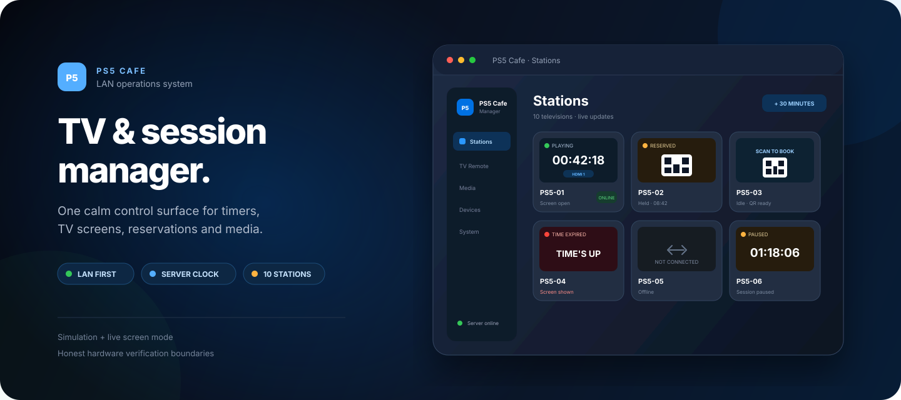
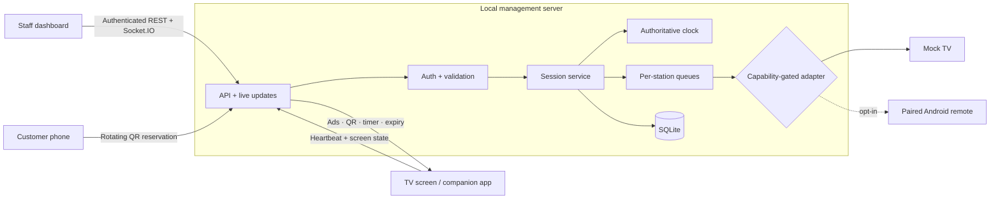

<div align="center">



# PS5 Cafe TV Manager

**A LAN-first control centre for timed gaming sessions, TV screens, QR reservations, media and staff operations.**

[](tsconfig.base.json)
[](package.json)
[](apps/server/src)
[](apps/web/src)
[](docs/ARCHITECTURE.md)
[](docs/HARDWARE_LIMITATIONS.md)

[Features](#what-it-does) · [TV support](#tv-support-right-now) · [Quick start](#quick-start) · [Live café mode](#live-café-mode) · [Architecture](#how-it-fits-together) · [Safety](#safety-boundaries)

</div>

> [!IMPORTANT]
> The server is authoritative for every timer and session transition. TV-side software displays the result; it does not own the clock. Software input switching and expiry screens are **not** tamper-proof access control.

## At a glance

| | Capability | Current behavior |
|---:|---|---|
| ⏱️ | **Session control** | Start, pause, resume, extend, end and expire sessions from one dashboard. |
| 📺 | **TV screens** | Each station gets its own ads, QR booking, active-session and time-expired screen. |
| 📱 | **QR reservations** | Customers reserve a TV from their phone; staff still start every paid session. |
| 🎞️ | **Media manager** | Upload validated JPEG, PNG, GIF, WebP, MP4 or WebM media for idle screens. |
| 🎮 | **Remote tools** | Opt-in Android remote keys, touch, screenshots and HDMI selection over paired wireless debugging. |
| 🔄 | **Live updates** | Socket.IO keeps every staff screen synchronized with server-owned state. |
| 💾 | **Recovery** | SQLite restores active and paused sessions after a restart without resetting time. |
| 🧪 | **Safe simulation** | Ten mock stations, fault injection and accelerated time without LAN traffic. |

## What it does

<table>
  <tr>
    <td width="25%" valign="top"><strong>Dashboard</strong><br><br>See all stations, filter by state and act on the sessions that need attention.</td>
    <td width="25%" valign="top"><strong>TV Remote</strong><br><br>Open one station, send supported keys and inspect an on-demand Android screenshot.</td>
    <td width="25%" valign="top"><strong>Media Manager</strong><br><br>Upload café artwork and muted video that rotates beside each idle TV's QR code.</td>
    <td width="25%" valign="top"><strong>Device Settings</strong><br><br>Open TV links, pair Android devices and see the exact capabilities available per station.</td>
  </tr>
</table>

- Server-authoritative deadlines with deterministic, injected clocks in tests.
- Per-station command queues, so one slow or offline TV cannot block another.
- Required idempotency keys on mutations, including replay protection across restarts.
- Distinct `SUCCESS`, `FAILURE`, `UNSUPPORTED`, `TIMEOUT`, `UNVERIFIED` and `DEVICE_OFFLINE` outcomes.
- Real-time connection, session, display-mode and expiry-evidence states—never compressed into one misleading status.
- Responsive desktop and phone layouts with five fixed areas: Dashboard, TV Remote, Media Manager, Device Settings and System Settings.

## TV support right now

Loading the screen page is not proof that remote control, HDMI switching or expiry enforcement works on that TV. Support is recorded by **exact model and firmware**.

| TV or platform | Status | Available today | Limits |
|---|---|---|---|
| **Hisense WE3FE / 75WE3FE VisionBoard**<br>Android 14 · CVTE panel | 🟠 **Partly supported**<br>Physically tested | Companion app, ads, rotating QR, heartbeat, timer overlay, Android TV Input Framework switching, expiry/idle return, paired ADB keys/touch/screenshots and screen on/off | Tested with a PC on HDMI 1—not a PS5. HDMI video is black in screenshots. Touch and system UI remain bypass paths. Backlight state cannot be read. |
| **Other Android TV / Google TV / Android panels** | ⚪ **Test required** | Screen page and companion APK are ready for model testing | Overlay, WebView, TV Input Framework and wireless-debugging behavior vary by model and firmware. |
| **Modern browser-only TV** | ⚪ **Screen-only candidate** | May show ads, QR booking, session and expiry pages | No verified input, remote or power control. Staff/customer uses the physical remote. |
| **Prism TV** | ⚪ **Not tested** | Nothing claimed yet | Exact model and OS must be identified first. |
| **Samsung Tizen / Hisense VIDAA / other platforms** | ⚪ **Not tested** | Possible browser-only path | No manufacturer control adapter is enabled. |
| **Mock TVs** | 🟢 **Supported for development** | Complete simulated session, input, remote, failure and offline flows | Software proof only; it makes no physical-TV claim. |

### Verified on the Hisense WE3FE

- The companion app renders the café screen, PNG/JPEG ads and muted H.264 MP4 video.
- Starting a session can tune the connected HDMI input inside the app; ending or expiry returns to the café screen.
- The timer overlay and automatic expiry return were exercised over the HDMI-player path.
- An explicitly paired device accepts supported Android keys, screenshot taps, source selection and separate backlight on/off commands.
- Every remote action remains `UNVERIFIED`: command delivery does not prove the final picture.

Still outstanding: a real PS5/game-mode test, reboot and boot-launch recovery, long-run performance, customer-network isolation and the full security matrix. See the [physical test record](docs/HARDWARE_LIMITATIONS.md) and [TV test plan](docs/TV_TEST_PLAN.md).

## Quick start

Requirements: **Node.js 24+** and **npm 11+**.

```bash
git clone https://github.com/rexzai1992/Ps5-Cafe-managing-system.git
cd Ps5-Cafe-managing-system
cp .env.example .env
npm install
npm run dev
```

Open **http://localhost:5173**. Development uses `local-dev-token` when no token is configured. Set `PS5_CAFE_API_TOKEN` before allowing other LAN clients to connect.

| Command | Purpose |
|---|---|
| `npm run dev` | Start the API on `:3000` and dashboard on `:5173`. |
| `npm run verify` | Run strict typechecks, 310 tests and production builds. |
| `npm run start` | Run the compiled server. |
| `npm run start:live` | Build and start live café mode on `:8080`. |
| `npm run handoff:claude` | Continue through the repository-native Claude Code handoff. |

<details>
<summary><strong>Ports already in use?</strong></summary>

```bash
PORT=3100 HOST=127.0.0.1 npm run dev -w @ps5-cafe/server
cd apps/web
VITE_API_TARGET=http://127.0.0.1:3100 npm run dev
```

</details>

## Live café mode

```bash
npm run start:live
```

The first run creates a git-ignored, owner-only `.env.live`, builds the application and serves the dashboard, TV screens and booking pages from:

```text
http://<this-Mac's-LAN-IP>:8080
```

### Live behavior

1. Sign in on each staff device with the password stored in `.env.live`.
2. Open **Device Settings → TV screens and QR booking**.
3. Open each station link on its assigned TV, using the browser or companion app.
4. Add advertising in **Media Manager**.
5. Keep manufacturer control adapters disabled until that exact model passes the hardware test record.

TVs default to **screen-only**. A specifically paired Android device may also use the bounded ADB remote channel, but the result remains `UNVERIFIED`. The dashboard calls a TV Online only while its screen page or companion service has polled within 15 seconds.

### QR reservation privacy

A customer may enter a Malaysian mobile number only with explicit consent. The number is used only for that booking, removed when the reservation closes and never retained longer than 24 hours. A reservation holds a TV; **staff start every session**. See [PRIVACY.md](docs/PRIVACY.md).

## How it fits together



| Layer | Owns | Never owns |
|---|---|---|
| `apps/server` | Time, transitions, persistence, authentication, queues and evidence | Browser-only timers or PS5 commands |
| `apps/web` | Staff UI, TV/booking pages and local presentation | Authoritative state or direct TV transports |
| `packages/contracts` | Shared strict TypeScript contracts | Device protocol implementations |
| `android/tv-companion` | Full-screen café page, timer overlay and tested TIF behavior | Session authority or secure HDMI locking |

Read the full [architecture](docs/ARCHITECTURE.md).

## Safety boundaries

> [!WARNING]
> This is a controlled-LAN prototype, not a tamper-proof console lock.

- Never expose ADB, Tizen control ports, the API or dashboard directly to the public internet.
- A successful command is not proof of the picture currently shown on the panel.
- HDMI/gameplay video is never continuously captured; on-demand Android screenshots normally show the hardware video layer as black.
- No PS5 command injection, rooting, firmware modification or public ADB exposure is used.
- Real transports remain disabled by default until manufacturer, model, firmware, command and result are physically recorded.
- Production hardening still needs role-based staff sessions, firewall rules, secret rotation and expanded security testing.

## Repository guide

```text
apps/server/                 Fastify API, Socket.IO, SQLite, timers and adapters
apps/web/                    React + Vite staff, TV and booking interfaces
packages/contracts/          Shared strict TypeScript contracts
android/tv-companion/        Native Android TV companion application
docs/ARCHITECTURE.md         System boundaries and design decisions
docs/HARDWARE_LIMITATIONS.md Physical compatibility and verification record
docs/TV_TEST_PLAN.md         Repeatable model-by-model physical test plan
docs/PRIVACY.md              QR booking data handling
docs/research/               Sourced TV-control and locking research
docs/agent/CURRENT_STATUS.md Verified project state and next task
```

## Verification

Current repository gate:

```text
TypeScript strict checks   ✓
Server tests              217 / 217
Dashboard tests            93 / 93
Production builds           ✓
```

Automated simulation, rendered-browser checks and physical-hardware proof are tracked separately. Passing the software suite does not promote an untested TV model to supported status.
